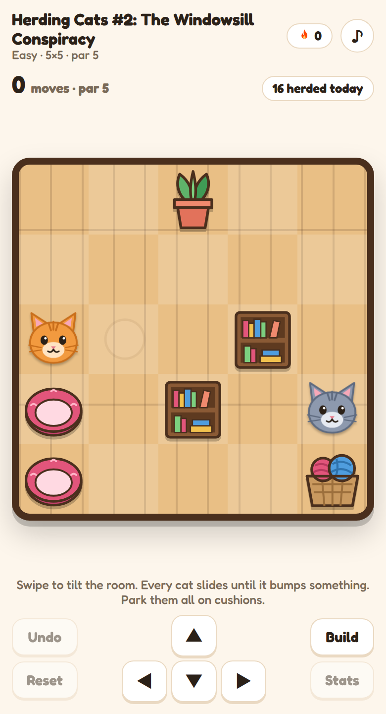
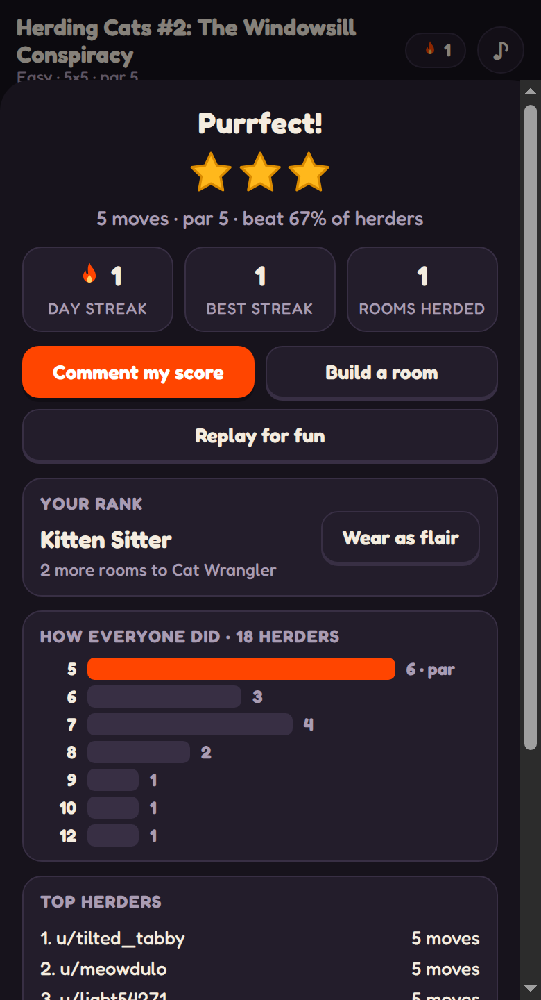
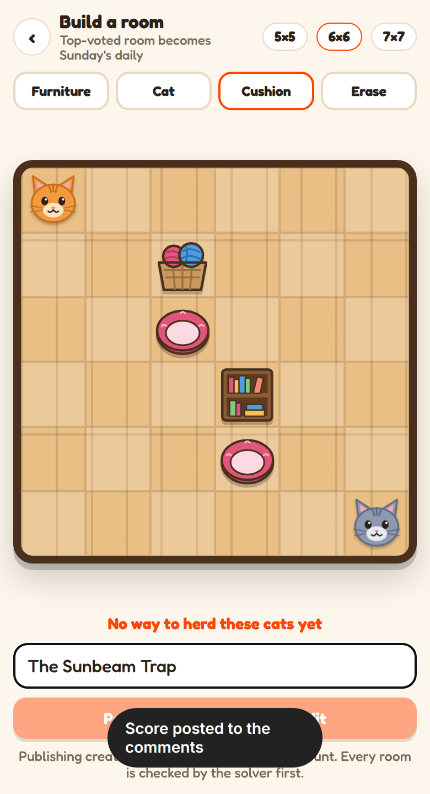

# Herding Cats

A daily tilt-the-room puzzle for Reddit, built on Devvit Web for [Reddit's Game of the Day hackathon](https://redditgameofday2026.devpost.com/).

One swipe tilts the whole room and **every cat slides at once** until it bumps into furniture, a wall or another cat. Park all the cats on cushions in as few moves as you can.

| Play                   | Results                      | Build a room                 |
| ---------------------- | ---------------------------- | ---------------------------- |
|  |  |  |

## How to play

1. Open today's Herding Cats post and tap **Herd the cats**.
2. Swipe on the room (or use the arrow buttons, arrow keys or WASD) to tilt it up, down, left or right.
3. All cats slide together until something stops them. Cats block each other, so order matters.
4. The room is solved when every cushion has a cat napping on it.
5. Finish at or under par for three stars. Undo and Reset are free, but only your **first solve** counts.

## What makes it a daily game

- **A new room every day at 00:00 UTC**, posted automatically by a scheduled job.
- **A weekly difficulty curve**: Monday is a 5x5 "Catnap" with two cats and par 4; it climbs through the week to Saturday's 7x7 "Fiendish" room.
- **Every room is calibrated by a solver**: the generator runs a breadth-first search over the whole room and only ships rooms whose shortest solution is exactly that day's par.
- **Streaks and ranks**: solve on consecutive days to grow a streak, and climb from Kitten Sitter to Cat Herding Legend as you herd more rooms.
- **Every room has a name**, like "The Windowsill Conspiracy".

## What makes it Reddit-y

- **See how everyone did**: after solving you get the community's move histogram, your percentile and the top herders of the day.
- **Comment my score**: one explicit tap posts a spoiler-free score line to the post's comments from your account.
- **Build a room**: a touch-friendly editor with a live solver that tells you the par, or that your room cannot be solved. Publishing creates a new playable post from your account.
- **Wear as flair**: one tap sets your rank and streak as your flair in the subreddit.
- **Community Sunday**: the most upvoted player-built room of the week becomes Sunday's daily, credited to its author. Upvotes decide what everyone plays.
- **Logged-out players can play the full game**; logging in adds streaks, the leaderboard and publishing.

## How it works

- `src/shared/game.ts`: the slide engine, BFS solver, seeded room generator and weekday tiers, shared by client and server.
- `src/server`: Hono routes on Devvit Web. Redis stores each post's room, first-solve results, histogram, leaderboard and streaks. Every submitted solution is replayed on the server before it counts.
- `src/client`: React. `splash.tsx` is the light inline view shown in the feed (it never traps scrolling); `game.tsx` is the expanded game, results sheet and room builder. Light and dark themes follow the device.
- `devvit.json`: entry points, the daily `scheduler` task, the moderator menu item and user-action permissions.

## Develop

```bash
npm install
npm run local        # play at http://localhost:5199/splash.html with an in-memory Reddit mock (add ?seed=1 for sample players)
npm run test:unit    # engine, solver and generator tests
npm run test:types && npm run lint && npm run build
npm run dev          # devvit playtest on your test subreddit (needs `npm run login`)
```

Moderators can post today's room at any time from the subreddit menu: **Post today's Herding Cats room**.

## License

BSD-3-Clause
